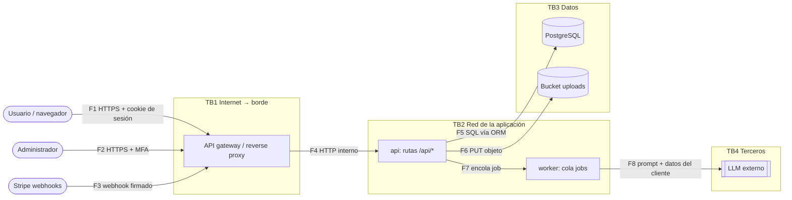

# Etapa 2: threat model

Contenido:

1. Las cuatro preguntas y qué técnicas usar
2. Del inventario al DFD
3. Plantilla Mermaid
4. STRIDE por elemento que cruza una frontera
5. LINDDUN cuando hay datos personales
6. Abuse cases
7. Respuesta por amenaza
8. Antipatrones del Manifesto
9. Validación antes de cerrar la etapa
10. Plantilla de `docs/security/threat-model.md`
11. Actualizar por diferencias

## 1. Las cuatro preguntas y qué técnicas usar

El método que recomienda OWASP (Threat Modeling Cheat Sheet, a partir del Threat Modeling Manifesto) es un ciclo de cuatro preguntas. Cada una produce una sección del documento:

| Pregunta | Sección del documento | Sale de |
|---|---|---|
| ¿En qué estamos trabajando? | Sistema, activos, DFD, trust boundaries, supuestos | `inventory.json` |
| ¿Qué puede salir mal? | Tabla de amenazas (STRIDE, LINDDUN), abuse cases | Esta etapa |
| ¿Qué vamos a hacer al respecto? | Respuesta por amenaza, con evidencia o GAP | Esta etapa y la 4 |
| ¿Lo hicimos suficientemente bien? | Validación, preguntas abiertas para el equipo | Sección 9 |

Elige técnicas por lo que el sistema tiene, y escribe en el documento por qué usaste cada una. El cheat sheet pide no añadir técnicas solo para parecer exhaustivo.

- **STRIDE**: siempre, sobre los elementos que cruzan una trust boundary.
- **LINDDUN**: solo si circulan o se guardan datos personales.
- **Abuse cases**: siempre que haya flujos de negocio con valor (pagos, cupones, reservas, invitaciones, cambios de rol, exportaciones).
- **Attack trees**: solo para un objetivo de alto valor con varios pasos (por ejemplo, tomar una cuenta de administrador). No los generes por defecto.

## 2. Del inventario al DFD

Construye el DFD desde `inventory.json`, no desde la imaginación. Cada elemento del diagrama debe poder señalar `file:line` o un archivo de configuración.

| Elemento DFD | Qué buscar en el repo | Ejemplos |
|---|---|---|
| Entidad externa | Quién inicia peticiones o recibe datos | Navegador, app móvil, otro servicio, proveedor de webhooks, operador de CI, LLM externo |
| Proceso | Código que recibe una entrada y decide | Rutas HTTP, resolvers GraphQL, consumidores de colas, cron, workers, comandos CLI, funciones serverless, agentes |
| Almacén de datos | Clientes de persistencia | ORM y migraciones, Redis, S3/blob, índices vectoriales, archivos locales, logs |
| Flujo de datos | Llamadas entre elementos | `fetch`/`requests`, SDKs de terceros, publicación en colas, consultas, subida de archivos |
| Trust boundary | Donde cambia el nivel de confianza o el dueño | Ver lista siguiente |

Fronteras típicas que debes comprobar una a una (márcalas solo si existen):

- internet ↔ borde (CDN, gateway, load balancer) y borde ↔ servicio
- usuario anónimo ↔ autenticado ↔ administrador
- tenant ↔ tenant
- servicio ↔ base de datos, cache o almacenamiento
- servicio ↔ terceros (pagos, email, SMS, APIs externas, webhooks entrantes)
- servicio ↔ red interna o metadata del cloud (fetchers de URL)
- CI ↔ producción (quién despliega, con qué credenciales)
- app ↔ LLM y LLM ↔ herramientas o servidores MCP (con `+llm`)

Para cada entry point anota en el inventario cómo se autentica y dónde se autoriza. Un entry point sin respuesta a esas dos preguntas ya es una amenaza candidata.

Si el sistema tiene más de unos 12 elementos, dibuja una vista general y una vista detallada por componente; no intentes meterlo todo en un diagrama.

## 3. Plantilla Mermaid

Las trust boundaries son `subgraph`. Los flujos que cruzan una frontera llevan un identificador (`F1`, `F2`...) que reutilizas en la tabla de amenazas.



Usa `([ ])` para entidades externas, `[ ]` para procesos, `[( )]` para almacenes y `[[ ]]` para servicios de terceros. Pon entre comillas las etiquetas con `:`, `/`, `*` o paréntesis para que Mermaid no falle. Etiqueta cada flujo con protocolo y credencial; esa etiqueta es lo que STRIDE examina.

## 4. STRIDE por elemento que cruza una frontera

Cada letra amenaza una propiedad:

| STRIDE | Propiedad | Pregunta concreta sobre el código |
|---|---|---|
| S Spoofing | Autenticación | ¿Puede alguien hacerse pasar por este usuario, servicio o emisor de webhook? ¿Se valida firma, audiencia y emisor del token? |
| T Tampering | Integridad | ¿Puede alterar el dato en tránsito, en el almacén o en el cliente (precio, rol, `tenant_id` en el body)? |
| R Repudiation | Trazabilidad | ¿Queda registro de quién hizo la acción sensible, con quién, cuándo y desde dónde? |
| I Information disclosure | Confidencialidad | ¿Qué devuelve de más (campos, errores, stack traces, logs, otros tenants)? |
| D Denial of service | Disponibilidad | ¿Qué operación cara puede repetir sin límite (búsquedas, exportaciones, SMS, tokens de LLM)? |
| E Elevation of privilege | Autorización | ¿Puede ejecutar una función o tocar un objeto que no es suyo? |

No apliques las seis letras a todo. Usa la tabla clásica de STRIDE por tipo de elemento para no generar ruido:

| Tipo de elemento | Letras que aplican |
|---|---|
| Entidad externa | S, R |
| Proceso | S, T, R, I, D, E |
| Almacén de datos | T, I, D (y R si es un log o auditoría) |
| Flujo de datos | T, I, D |

Registra cada amenaza en una fila: `T-NNN`, elemento o flujo (`F4`), frontera, letra STRIDE, descripción en una frase, respuesta, evidencia y hallazgo vinculado (`IMPL-`/`DES-`). Una amenaza real del sistema vale más que seis genéricas: si no puedes decir qué archivo la mitiga o por qué falta, no la escribas.

Con `+llm`, cruza además la frontera app↔LLM con LLM01, LLM05, LLM06 y LLM08, y la frontera LLM↔herramienta con ASI02 y ASI03 (ver `reference/llm-y-agentes.md`).

## 5. LINDDUN cuando hay datos personales

Actívalo si el inventario muestra datos personales (perfiles, email, teléfono, ubicación, salud, pagos, contenido de usuarios enviado a un LLM). Aplícalo al mismo DFD, solo a los flujos y almacenes con esos datos:

| Categoría | Pregunta |
|---|---|
| Linking | ¿Se pueden enlazar registros de una persona entre contextos (IDs estables, trackers)? |
| Identifying | ¿Se puede identificar a alguien a partir de datos supuestamente anónimos o seudónimos? |
| Non-repudiation | ¿El sistema obliga a dejar prueba de algo que el usuario debería poder negar o mantener privado? |
| Detecting | ¿Se puede deducir que una persona existe o hizo algo (enumeración, respuestas distintas)? |
| Data disclosure | ¿Se recogen, guardan o envían más datos personales de los necesarios, o a terceros (analytics, LLM)? |
| Unawareness / unintervenability | ¿El usuario sabe qué se hace con sus datos y puede consultarlos, corregirlos o borrarlos? |
| Non-compliance | ¿Hay retención, consentimiento o base legal sin implementar? |

Las amenazas LINDDUN usan el mismo identificador `T-NNN` y la columna de técnica dice `LINDDUN-<categoría>`.

## 6. Abuse cases

Para cada flujo de negocio con valor, escribe cómo se abusa de un uso **válido**: pasos fuera de orden, repetidos, concurrentes o a escala. Los ejemplos de A06:2025 sirven de patrón: un límite de reservas de grupo que se evita con muchas peticiones pequeñas, o bots de reventa sin defensa anti-automatización.

```
AC-003 Cupón aplicado más de una vez
Actor: cliente autenticado (o bot con muchas cuentas)
Flujo legítimo: POST /cart/coupon → POST /checkout
Abuso: enviar POST /cart/coupon en paralelo 20 veces antes del checkout
Invariante que debe cumplirse: un cupón se aplica como máximo una vez por pedido y por usuario
Control esperado: restricción única en BD o bloqueo transaccional; idempotency key en checkout
Evidencia actual: src/cart/coupon.ts:58 (comprueba y luego escribe, sin transacción) → GAP
Test propuesto: tests/security/test_abuse_coupon.py::test_parallel_coupon_applies_once
Mapeo: A06, API6, ASVS v5.0.0-2.3.4, v5.0.0-15.4.2
```

Fuentes de abuse cases en el código: precios o cantidades que llegan del cliente, contadores y saldos, flujos de varios pasos (checkout, onboarding, recuperación de cuenta), invitaciones y cambios de rol, envío de SMS o email, exportaciones masivas, llamadas a LLM pagadas por uso. Cada abuse case confirmado por una persona se convierte en test en la etapa 7.

## 7. Respuesta por amenaza

Cada amenaza termina con una de estas respuestas, o con GAP:

| Respuesta | Cuándo | Qué registras |
|---|---|---|
| Mitigate | Existe o se propone un control que reduce probabilidad o impacto | El control y su evidencia `file:line`, o el hallazgo que pide crearlo |
| Eliminate | Se quita la funcionalidad o el flujo que crea la amenaza | Qué se elimina y quién lo decide |
| Transfer | Otro asume el riesgo (proveedor, IdP, seguro, cliente por contrato) | **Dueño del riesgo residual** y documento que lo respalda; transferir no reduce probabilidad ni impacto |
| Accept | El riesgo se asume conscientemente | Dueño, motivo y fecha de revisión; si es un hallazgo, va a `docs/security/exceptions.json` con `owner`, `expires` y `reason` |
| GAP | No hay control y nadie decidió | Hallazgo `DES-` o `IMPL-` vinculado; nunca lo dejes sin vincular |

El modelo no decide por el equipo `Accept` ni `Transfer`: propónlos y márcalos "pendiente de confirmación humana". Una mitigación acordada se convierte en requisito de seguridad y, si se puede, en test.

## 8. Antipatrones del Manifesto

| Antipatrón | Cómo se manifiesta en la salida de un LLM | Qué haces en su lugar |
|---|---|---|
| Admiration for the Problem | Tablas largas de amenazas sin respuesta ni acción | Cada fila termina en respuesta, evidencia o GAP con hallazgo |
| Perfect Representation | Un DFD enorme que intenta ser "el modelo correcto" | Vista general + vistas por componente; anota supuestos y preguntas abiertas |
| Tendency to Overfocus | Veinte amenazas de un endpoint y ninguna de CI o de terceros | Recorre todas las fronteras de la sección 2 antes de profundizar |
| Hero Threat Modeler | El modelo se presenta como definitivo, sin el equipo | Marca lo que necesita confirmación humana y lista preguntas para el equipo |

Los valores del Manifesto que guían la etapa: arreglar problemas de diseño antes que cumplir checklists, comprensión continua antes que una foto fija, y refinar el modelo antes que entregar un documento único.

## 9. Validación antes de cerrar la etapa

- [ ] El DFD coincide con el inventario: cada entry point, almacén y llamada saliente aparece, y cada elemento tiene evidencia.
- [ ] Todas las fronteras de la sección 2 que existen están dibujadas.
- [ ] Cada amenaza tiene respuesta o GAP con hallazgo vinculado.
- [ ] Las mitigaciones se pueden probar (hay test o se propone uno).
- [ ] Está escrito qué técnicas se usaron y por qué, y cuáles no.
- [ ] Lo que se transfiere o acepta tiene dueño, o está marcado como pendiente de confirmación.
- [ ] El documento registra commit, fecha y modelo.

## 10. Plantilla de `docs/security/threat-model.md`

````markdown
# Threat model: <nombre del sistema>

> Estado: borrador generado por owasp-audit, **pendiente de confirmación humana**.
> Commit: <sha> · Fecha: <AAAA-MM-DD> · Modelo: <modelo> · Versión del documento: <n>

## 1. ¿En qué estamos trabajando?
Propósito del sistema en dos frases. Usuarios y roles. Despliegue (dónde corre, quién despliega).

### Activos
| Activo | Clasificación | Dónde vive |
|---|---|---|

### Supuestos
- (por ejemplo: TLS termina en el load balancer; no verificable desde el repo)

### DFD
```mermaid
(diagrama de la sección 3)
```

### Trust boundaries y entry points
| Frontera | Entry point | Autenticación | Autorización (dónde) | Evidencia |
|---|---|---|---|---|

## 2. ¿Qué puede salir mal?
Técnicas usadas y motivo: STRIDE (…), LINDDUN (… / no aplicada porque …), abuse cases (…).

| ID | Elemento / flujo | Frontera | Técnica | Amenaza | Respuesta | Evidencia | Hallazgo |
|---|---|---|---|---|---|---|---|
| T-001 | F4 gw→api | TB2 | STRIDE-E | Un usuario lee pedidos de otro cambiando el id | GAP | absence: rg 'owner_id' src/orders = 0 | IMPL-007 |

### Abuse cases
(bloques AC-NNN de la sección 6)

## 3. ¿Qué vamos a hacer al respecto?
| Amenaza | Acción propuesta | Tipo (Mitigate/Eliminate/Transfer/Accept) | Dueño | Test |
|---|---|---|---|---|

## 4. ¿Lo hicimos suficientemente bien?
Checklist de validación (sección 9) con su estado. Preguntas abiertas para el equipo. Qué no se modeló y por qué.

## Historial de cambios
| Versión | Fecha | Commit | Cambios |
|---|---|---|---|
````

## 11. Actualizar por diferencias

Si `docs/security/threat-model.md` ya existe, no lo reescribas:

1. Lee el commit registrado en el documento y compáralo con el actual (`git diff --stat <sha_anterior>..HEAD`) y con el `inventory.json` nuevo.
2. Añade los elementos, flujos y fronteras nuevos; marca los que desaparecieron como "retirado en <commit>" en lugar de borrarlos.
3. Conserva los IDs `T-NNN`, `AC-NNN` y `F<n>`; los nuevos continúan la numeración.
4. Revisa solo las amenazas afectadas por el cambio y las que estaban en GAP; actualiza su respuesta y evidencia.
5. Respeta lo que una persona confirmó o editó (respuestas `Accept`, dueños, supuestos): no lo cambies; si la evidencia nueva lo contradice, añade una nota y pregunta.
6. Añade una fila al historial con versión, fecha, commit y un resumen de lo cambiado, y menciona ese resumen en el informe.
